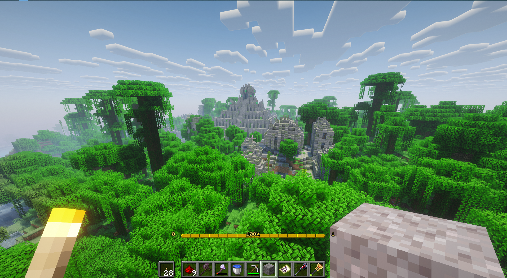
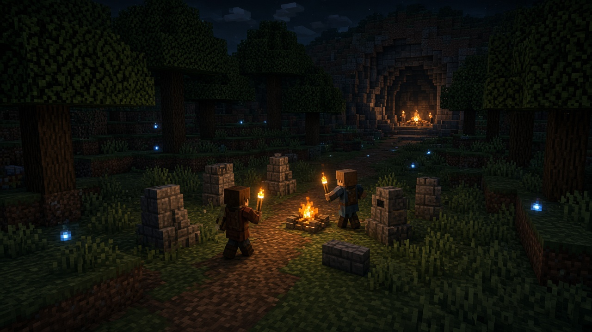
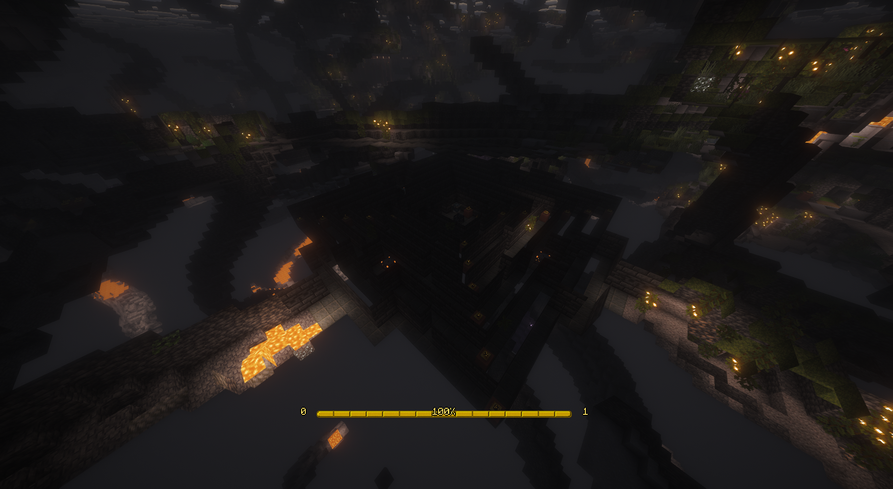
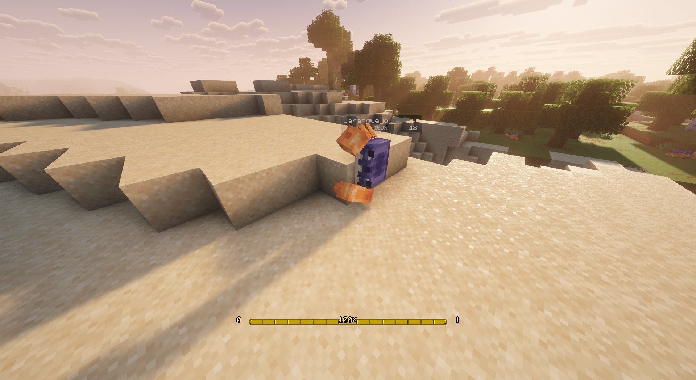

# MineServer

[Baixar o MineServer](https://github.com/JacobsenNando/MineServer/archive/refs/heads/master.zip)

[Guia do jogador](docs/guia.md) · A versão navegável está em `docs/guia.html` dentro do ZIP.

O botão verde **Code** desta página pede o Git. Pode ignorar. O link acima baixa um zip pronto, e o Python também fica de fora.

No Windows, abre os Downloads, clica com o botão direito em `MineServer-master.zip` e escolhe **Extrair tudo**. Abre a pasta `MineServer-master` e dá dois cliques em `Instalar.bat`. Se aparecer um aviso azul, clica em **Mais informações** e em **Executar assim mesmo**. Guarda essa pasta. Na próxima atualização, o mesmo `Instalar.bat` busca a versão nova. O Minecraft tem que estar fechado.

No Linux, extrai o mesmo zip e dá dois cliques em **Instalar MineServer**. Se o arquivo abrir como texto, entra na pasta, abre o terminal e escreve `bash instalar.sh`. Se o perfil MineServer já existe, os mods vão para a pasta desse perfil. Na próxima vez, o mesmo comando busca a versão nova.

A janela pergunta dos shaders. Enter deixa sem. `s` instala, e o jogo fica mais bonito e mais pesado.

Entra. O mundo já está andando, e ele continua sendo Minecraft: madeira, ferro, diamante, netherite, Nether e o dragão. A diferença é que a gente sai de casa junto, e o personagem cresce no caminho.

A selva daqui tem ruína de pedra no meio das árvores. A mina desce fundo. A praia também existe.



*Print do mundo. Ruína na selva.*

## Como o servidor funciona

É um mundo só, de sobrevivência, para um grupo pequeno. O que você constrói fica. O que o grupo explora fica. Quando você sai, o lugar continua lá para quem entrar depois.

Todo mundo usa o mesmo cliente. Sem ele, a porta não abre: o servidor espera os mods dos dois lados. O instalador desta página monta o perfil **MineServer** no Minecraft oficial e no SKLauncher.

O nome que você coloca no launcher é o nome que aparece em cima da cabeça. Entra com o seu.

O endereço o grupo manda no chat. Ele não fica escrito aqui.

Morrer dói, e o inventário volta com você. A barra de fome, a noite e o dano de queda continuam valendo.

Baú de masmorra, vila, cemitério e estrutura parecida é seu. Ele nasce dourado. Depois que você abre, fica azul, e o loot de dentro é o seu. O baú que a gente coloca na base é compartilhado, como sempre foi.

Waystone aparece em vila de terreno novo. Ativou uma, viaja para as outras que você já ativou. Chão que o grupo já andou não ganha waystone sozinho.

Na base, os baús podem se ligar, e a mochila do viajante carrega um pedaço da casa nas costas.

## A escolha de classe

Você escolhe um jeito de jogar, e o jogo também te ensina outro por baixo.

**O que sobe sozinho.** Enquanto você minera, corta árvore, luta, atira, pesca, planta, cava, se defende, corre, escala, anda agachado, forja, faz poção e encanta, quinze habilidades sobem com a prática. O bônus soma com o encantamento da ferramenta. A barra aparece na tela. Ninguém escolhe isso num menu: a habilidade sobe porque você fez a ação.

**O que você escolhe.** A tecla **K** abre a árvore de habilidades. São duas telas.

A da classe cabe 13 pontos. O primeiro caminho que você abre trava os outros. A das armas cabe 6 pontos, e dá para abrir mais de um caminho. O ponto sai da experiência de matar criatura. Quem está no mesmo time, até 200 blocos, recebe a mesma experiência. A árvore já abre em português.

Quem já tinha pontos na árvore antiga começa esta do zero. O acerto crítico passa a valer no golpe e na flecha. Peça de guerreiro, ladino, joia e relíquia que já trazia crítico passa a usar esse número.

## Classes de combate

A tecla **K** abre a árvore. O livro de feitiços é outro caminho: ele muda o jeito de lutar. O caminho da árvore se escolhe nela mesma.

A tecla J abre a ficha com a vida, o dano, a armadura e o resto que o jogo já somou. O H continua empinando o cavalo. A troca fica em Controles, na categoria Diversos.

A mesa de encadernação aparece no gazebo de vila em terreno novo. Dá para construir a sua. Estante ao redor, como na mesa de encantamentos. O livro fica equipado, e a arma fica na mão.

| Classe | Para começar | O que ela faz |
| --- | --- | --- |
| Mago de fogo | um cajado ou uma varinha de fogo | tomo de fogo. A runa é a munição |
| Mago de gelo | um cajado ou uma varinha de gelo | tomo de gelo. A runa é a munição |
| Mago arcano | um cajado ou uma varinha arcana | tomo arcano. A runa é a munição |
| Arqueiro | um arco ou uma besta | o manual de arquearia vale em qualquer arco |
| Paladino | um martelo, uma maça ou uma claymore | protege o grupo e bate de perto. O escudo cabe |
| Sacerdote | um cajado ou uma varinha sagrada | cura e protege |
| Ladino | uma adaga ou uma foice, nas duas mãos | desvia e engana |
| Guerreiro | um machado duplo, uma glaive ou uma claymore | quebra a guarda e esmaga |

O primeiro livro criado na mesa de encadernação escolhe a classe. Um tomo novo de outra classe, criado nessa mesa, troca a classe. Os pontos já gastos na árvore voltam inteiros, um por nó aprendido. Fogo, gelo e arcano ficam separados. Paladino, sacerdote, arqueiro, ladino e guerreiro ficam cada um no seu. Antes desse livro, só arma do vanilla equipa. Armadura, joia, relíquia e runa continuam. Depois, o equipamento de outra classe volta para o inventário. O tomo, o cajado, a varinha e a túnica de outra escola também. A varinha de novato, o cajado simples e a túnica de mago servem para as três escolas. Espada, arco e armadura do vanilla continuam. Joia, relíquia e runa também. A mesa de cada classe continua livre.

Quem já era Mago escolhe a escola no próximo tomo criado nessa mesa. Até lá, as três escolas continuam com ele.

A arma lendária do Arsenal segue o tipo. O mago de fogo, o de gelo e o arcano usam cajado e claymore. O cajado de cura também cabe no sacerdote. O paladino usa claymore, martelo, maça e escudo. O guerreiro usa claymore, machado duplo, glaive, lança e a espada longa. O arqueiro usa arco e besta. O ladino usa adaga e foice. Maça e escudo ficam fora do mago.

O pergaminho de esquecimento leva um livro, um fragmento de ametista e obsidiana chorona. Usar o pergaminho devolve o equipamento da classe, devolve os pontos da árvore e abre a escolha de novo.

Anel, colar, livro, aljava, cinto e mochila ficam numa coluna ao lado do personagem, sem precisar passar o mouse. O instalador grava isso em `config/trinkets.json`, com a coluna sempre visível e doze espaços. Feche o jogo e abra de novo para a coluna aparecer.

A runa se crafta na mão. O altar de runas devolve mais peças com o mesmo material.

A joia nasce de gema na profundidade do diamante. O anel e o colar entram no espaço de berloque.

Torre de mago, santuário e loja de joias só nascem em terreno que ainda não foi gerado.

O mod de ladinos e guerreiros recalibra Afiação, Julgamento e Ruína dos artrópodes. O de arqueiros recalibra Poder e Carga rápida. O número novo vale para todo mundo.

## Por que o pacote é este

A ideia é um Minecraft um pouco mais de RPG, sem trocar a progressão. A arma nova entra na mão. A armadura nova entra no visual do vanilla. O perigo extra mora na noite, na mina, no acampamento illager, na masmorra e no cemitério. Caverna de enxofre é da própria 26.2. Nenhuma dimensão nova.

As armas que se craftam estão na aba de receitas. As lendárias não têm receita: elas esperam o fim do caminho, na cidade do End, no dragão, no wither e no warden. O baú da mina não entrega isso.



*Ilustração. A noite é a hora de ir junto.*



*Print do mundo. A mina desce.*



*Print do mundo. A praia, o Caranguejo e um golem de cobre.*

## O que cada mod faz

Estes mudam a sua partida:

- **Better Combat.** Cada tipo de arma tem alcance e golpe próprios.
- **Weapons Expanded.** Armas novas, com receita.
- **Damage Tester.** Boneco para testar arma e feitiço. A receita é fardo de feno no meio, graveto dos lados e suporte de armadura embaixo. O golpe mostra o dano, o DPS e o total. Botão direito veste armadura nele. Agachar e bater de mão vazia recolhe.
- **Livro de encantamento.** Passar o mouse no livro mostra, em cinza, o que aquele nível faz. A arma e a armadura encantadas mostram a mesma linha.
- **Arsenal.** Armas lendárias, achadas no fim do jogo.
- **Immersive Armors.** Conjuntos de armadura no visual do vanilla.
- **Relics** e **Trinkets.** Amuletos no espaço de berloque.
- **Skill Tree (RPG Series).** A árvore das classes, na tecla K. Os pontos vêm da experiência, e a experiência é compartilhada com o time.
- **Wizards, Archers, Paladins & Priests, Rogues & Warriors.** As classes de combate e os livros de feitiço.
- **Runes.** A munição do mago, do paladino e do sacerdote.
- **Jewelry.** Anel e colar no espaço de berloque.
- **Skill Proficiencies.** As quinze habilidades que sobem fazendo. Arquearia sobe com qualquer arco e qualquer besta.
- **Friends & Foes.** Criaturas que vieram das votações de mob.
- **Illager Invasion.** Acampamento e raid de illager mais bravos. Dá para contornar.
- **The Graveyard.** Cemitério, morto-vivo e chefe nesses lugares.
- **Dungeons and Taverns.** Masmorra e taverna de bloco vanilla. O grupo entra quando quer.
- **Towns and Towers.** Vila e torre a mais, em terreno que ainda não foi gerado.
- **Waystones.** O ponto de viagem nas vilas novas.
- **Icy's Better Horses.** Domesticar o cavalo o torna seu. O vínculo sobe a velocidade e o pulo. P chama o cavalo, G lista os seus, e R manda seguir, ficar ou voltar para casa. A carroça leva quatro pessoas e um baú.
- **Lootr.** O baú de estrutura vira o seu baú.
- **Tom's Simple Storage.** Baús da base ligados entre si.
- **Traveler's Backpack.** A mochila.
- **Frostbyte's Slabs & Stairs.** Laje, escada e muro de blocos que o jogo não corta, inclusive a calcita. Na mesa de corte, um bloco vira duas lajes ou uma escada.
- **Rechiseled.** O cinzel (barra de ferro em cima do graveto) abre uma tela. Ela troca pedra, madeira e outros blocos por tijolo, pilar, ladrilho e a laje e a escada de cada padrão, um por um. A calcita continua no Frostbyte.
- **Just Enough Items.** A tecla E abre o inventário com itens e receitas do pacote do lado. A mesa de encadernação e o corte de gema aparecem aí.
- **Neat.** A vida do mob e do amigo aparece em cima deles.
- **Remnants Minimap.** **M** abre o mapa. **N** esconde o minimapa até você fechar o jogo.

Estes deixam o jogo mais leve no seu computador: Sodium, Entity Culling, ImmediatelyFast, Bad Optimizations e Dynamic FPS. Se na instalação você digitar `s`, entram também o Iris e o shader Complementary. Ele deixa o mundo mais bonito e mais pesado. Enter segue sem shader.

O resto entra porque os mods de cima precisam: Fabric API, Spell Engine, Spell Power, Player Animation Library, GeckoLib, Modonomicon, Balm, Cloth Config, Puzzles Lib, Cristel Lib, Resourceful Lib, Forge Config API Port, Cardinal Components, AttributeFix, Prickle, Ranged Weapon API, Armor Model API, Bundle API, Structure Pool API, Villagers Trading Plus, Shogi, Lithium, FerriteCore, Krypton, Clumps, Fusion, SuperMartijn642's Core Lib e SuperMartijn642's Config Library. A lista com link e arquivo está em [requirements/REQUISITOS.md](requirements/REQUISITOS.md).

## Para entrar

O download e o instalador estão no começo desta página. Quando a janela terminar:

1. Abra o Minecraft oficial ou o SKLauncher.
2. Escolha o perfil MineServer.
3. Entre com o seu nome.
4. Use o endereço que o grupo mandou no chat.

O launcher baixa o Java 25 na primeira vez que o perfil abre. Com 8 GB de memória o computador respira melhor.

## Se você cuida do servidor

Quando um mod mudar na pasta `mods` do servidor:

```sh
python3 scripts/sync_requirements.py /caminho/da/pasta/mods
```

Isso reescreve a ficha e a lista. Quem só vai jogar não roda esse comando.

Para colocar no servidor os mods que os dois lados usam, na hora de instalar:

```sh
bash instalar.sh --server-dir /caminho/do/servidor
```

No Windows o mesmo é `powershell -File instalar.ps1 -ServerDir C:\caminho\do\servidor`. A pasta é a do servidor, a que contém `mods`. O instalador copia o MineServer Classes para o cliente e, com `--server-dir`, para o servidor. No servidor ele trava a classe e o ponto. No cliente ele esconde o caminho que a classe não usa.
