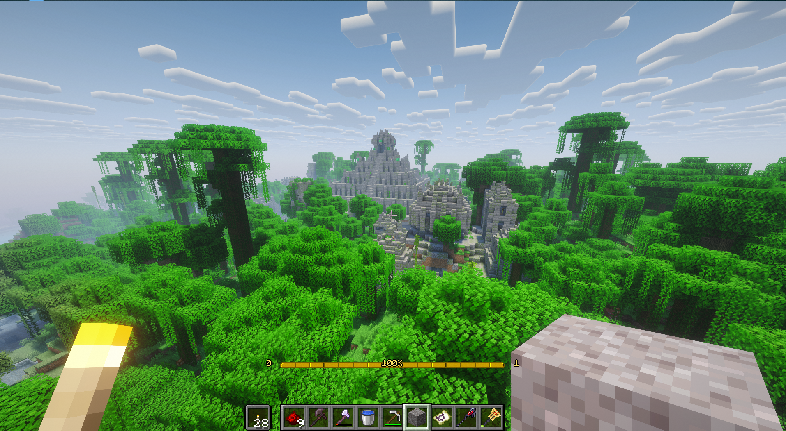
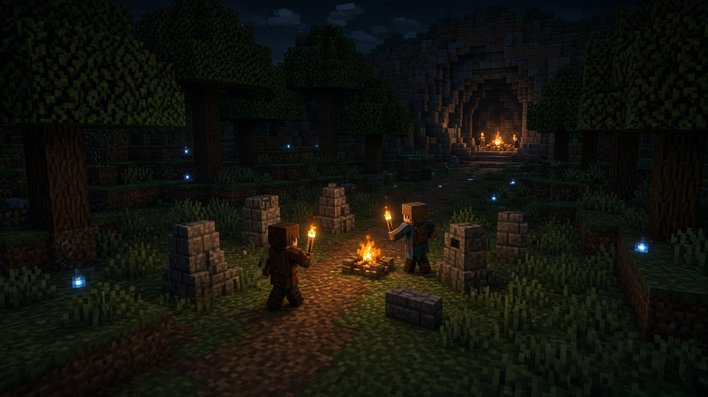
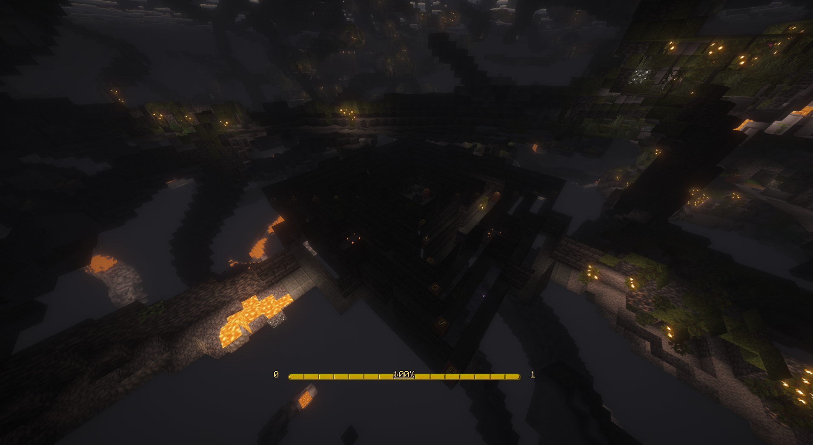
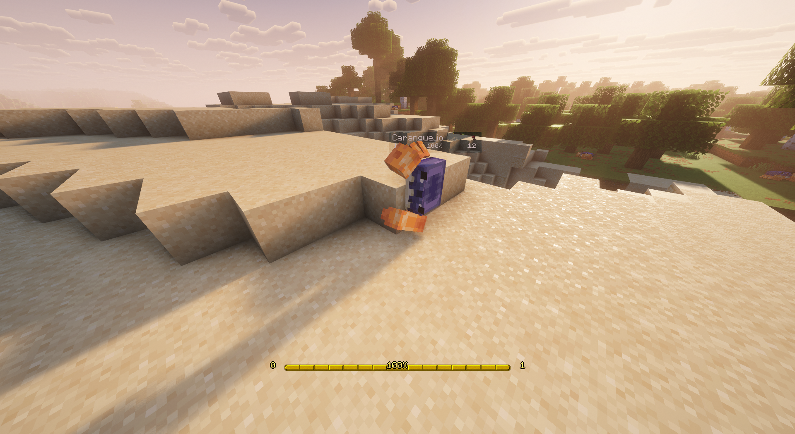

# MineServer

[Baixar o MineServer](https://github.com/JacobsenNando/MineServer/archive/refs/heads/master.zip)

O botão verde **Code** desta página pede o Git. Pode ignorar. O link acima baixa um zip pronto, e o Python também fica de fora.

No Windows, abre os Downloads, clica com o botão direito em `MineServer-master.zip` e escolhe **Extrair tudo**. Abre a pasta `MineServer-master` e dá dois cliques em `Instalar.bat`. Se aparecer um aviso azul, clica em **Mais informações** e em **Executar assim mesmo**.

No Linux, extrai o mesmo zip e dá dois cliques em **Instalar MineServer**. Se o arquivo abrir como texto, entra na pasta, abre o terminal e escreve `bash instalar.sh`. Se o perfil MineServer já existe, os mods vão para a pasta desse perfil.

A janela pergunta dos shaders. Enter deixa sem. `s` instala, e o jogo fica mais bonito e mais pesado.

Entra. O mundo já está andando, e ele continua sendo Minecraft: madeira, ferro, diamante, netherite, Nether e o dragão. A diferença é que a gente sai de casa junto, e o personagem cresce no caminho.

A selva daqui tem ruína de pedra no meio das árvores. A mina desce fundo. A praia também existe.



*Print do mundo. Ruína na selva.*

## Como o servidor funciona

É um mundo só, de sobrevivência, para um grupo pequeno. O que você constrói fica. O que o grupo explora fica. Quando você sai, o lugar continua lá para quem entrar depois.

Todo mundo usa o mesmo cliente. Sem ele, a porta não abre: o servidor espera os mods dos dois lados. O instalador desta página monta o perfil **MineServer** no Minecraft oficial e no SKLauncher.

O nome que você coloca no launcher é o nome que aparece em cima da cabeça. Entra com o seu.

O endereço o grupo manda no chat. Ele não fica escrito aqui.

Morrer dói, e o inventário volta com você. A barra de fome, a noite e o dano de queda continuam valendo.

Baú de masmorra, vila, cemitério e estrutura parecida é seu. Ele nasce dourado. Depois que você abre, fica azul, e o loot de dentro é o seu. O baú que a gente coloca na base é compartilhado, como sempre foi.

Waystone aparece em vila de terreno novo. Ativou uma, viaja para as outras que você já ativou. Chão que o grupo já andou não ganha waystone sozinho.

Na base, os baús podem se ligar, e a mochila do viajante carrega um pedaço da casa nas costas.

## A escolha de classe


*Ilustração. Da esquerda para a direita: Caçador, Alquimista, Cozinheiro e Ferreiro.*

Você escolhe um jeito de jogar, e o jogo também te ensina outro por baixo.

**O que sobe sozinho.** Enquanto você minera, corta árvore, luta, atira, pesca, planta, cava, se defende, corre, escala, anda agachado, forja, faz poção e encanta, quinze habilidades sobem com a prática. O bônus soma com o encantamento da ferramenta. A barra aparece na tela. Ninguém escolhe isso num menu: a habilidade sobe porque você fez a ação.

**O que você escolhe.** A tecla **O** abre a árvore de habilidades. Ali estão as classes. A experiência que você junta vira ponto. O primeiro ponto é barato. Os seguintes vão ficando caros, então gasta com calma. Dá para investir em mais de uma árvore. A classe é um caminho, e o grupo fica mais forte quando os caminhos são diferentes.

Para a árvore abrir de verdade, crafte uma vez o item que apresenta a classe:

| Classe | Para começar | O que ela puxa |
| --- | --- | --- |
| Caçador | um arco | flecha, couro, movimento enquanto mira |
| Alquimista | um suporte de poções | veneno, poção, frasco arremessado, cura |
| Cozinheiro | uma fornalha | comida, pesca, vida, recuperação |
| Ferreiro | uma mesa de ferraria | armadura, escudo, lâmina, ferramenta |

No fundo da árvore do Ferreiro abre um caminho de maça. Ele fica escondido até os nós finais dessa classe.

Se a build não ficou boa, o Pergaminho da Amnésia zera a árvore. Vinte por cento dos pontos ficam para trás. O dragão pode deixar um desses pergaminhos.

## Por que o pacote é este

A ideia é um Minecraft um pouco mais de RPG, sem trocar a progressão. A arma nova entra na mão. A armadura nova entra no visual do vanilla. O perigo extra mora na noite, na mina, no acampamento illager, na masmorra e no cemitério. Caverna de enxofre é da própria 26.2. Nenhuma dimensão nova.

As armas que se craftam estão na aba de receitas. As lendárias não têm receita: elas esperam o fim do caminho, na cidade do End, no dragão, no wither e no warden. O baú da mina não entrega isso.



*Ilustração. A noite é a hora de ir junto.*



*Print do mundo. A mina desce.*



*Print do mundo. A praia, o Caranguejo e um golem de cobre.*

## O que cada mod faz

Estes mudam a sua partida:

- **Better Combat.** Cada tipo de arma tem alcance e golpe próprios.
- **Weapons Expanded.** Armas novas, com receita.
- **Arsenal.** Armas lendárias, achadas no fim do jogo.
- **Immersive Armors.** Conjuntos de armadura no visual do vanilla.
- **Relics** e **Trinkets.** Amuletos no espaço de berloque.
- **Passive Skill Tree.** As classes e a árvore da tecla O.
- **Skill Proficiencies.** As quinze habilidades que sobem fazendo.
- **Friends & Foes.** Criaturas que vieram das votações de mob.
- **Illager Invasion.** Acampamento e raid de illager mais bravos. Dá para contornar.
- **The Graveyard.** Cemitério, morto-vivo e chefe nesses lugares.
- **Dungeons and Taverns.** Masmorra e taverna de bloco vanilla. O grupo entra quando quer.
- **Towns and Towers.** Vila e torre a mais, em terreno que ainda não foi gerado.
- **Waystones.** O ponto de viagem nas vilas novas.
- **Lootr.** O baú de estrutura vira o seu baú.
- **Tom's Simple Storage.** Baús da base ligados entre si.
- **Traveler's Backpack.** A mochila.
- **Frostbyte's Slabs & Stairs.** Laje, escada e muro de blocos que o jogo não corta, inclusive a calcita. Na mesa de corte, um bloco vira duas lajes ou uma escada.
- **Rechiseled.** O cinzel (barra de ferro em cima do graveto) abre uma tela. Ela troca pedra, madeira e outros blocos por tijolo, pilar, ladrilho e a laje e a escada de cada padrão, um por um. A calcita continua no Frostbyte.
- **Roughly Enough Items.** A tecla E abre o inventário com itens e receitas do pacote do lado.
- **Neat.** A vida do mob e do amigo aparece em cima deles.
- **Remnants Minimap.** **M** abre o mapa. **N** esconde o minimapa até você fechar o jogo.

Estes deixam o jogo mais leve no seu computador: Sodium, Entity Culling, ImmediatelyFast, Bad Optimizations e Dynamic FPS. Se na instalação você digitar `s`, entram também o Iris e o shader Complementary. Ele deixa o mundo mais bonito e mais pesado. Enter segue sem shader.

O resto entra porque os mods de cima precisam: Fabric API, Spell Engine, Spell Power, Player Animation Library, GeckoLib, Balm, Cloth Config, Puzzles Lib, Cristel Lib, Resourceful Lib, Forge Config API Port, Architectury, Cardinal Components, AttributeFix, Prickle, Ranged Weapon API, Villagers Trading Plus, Shogi, Lithium, FerriteCore, Krypton, Clumps, Fusion, SuperMartijn642's Core Lib e SuperMartijn642's Config Library. A lista com link e arquivo está em [requirements/REQUISITOS.md](requirements/REQUISITOS.md).

## Para entrar

O download e o instalador estão no começo desta página. Quando a janela terminar:

1. Abra o Minecraft oficial ou o SKLauncher.
2. Escolha o perfil MineServer.
3. Entre com o seu nome.
4. Use o endereço que o grupo mandou no chat.

O launcher baixa o Java 25 na primeira vez que o perfil abre. Com 8 GB de memória o computador respira melhor.

## Se você cuida do servidor

Quando um mod mudar na pasta `mods` do servidor:

```sh
python3 scripts/sync_requirements.py /caminho/da/pasta/mods
```

Isso reescreve a ficha e a lista. Quem só vai jogar não roda esse comando.

Para colocar no servidor os mods que os dois lados usam, na hora de instalar:

```sh
bash instalar.sh --server-dir /caminho/do/servidor
```

No Windows o mesmo é `powershell -File instalar.ps1 -ServerDir C:\caminho\do\servidor`. A pasta é a do servidor, a que contém `mods`.
